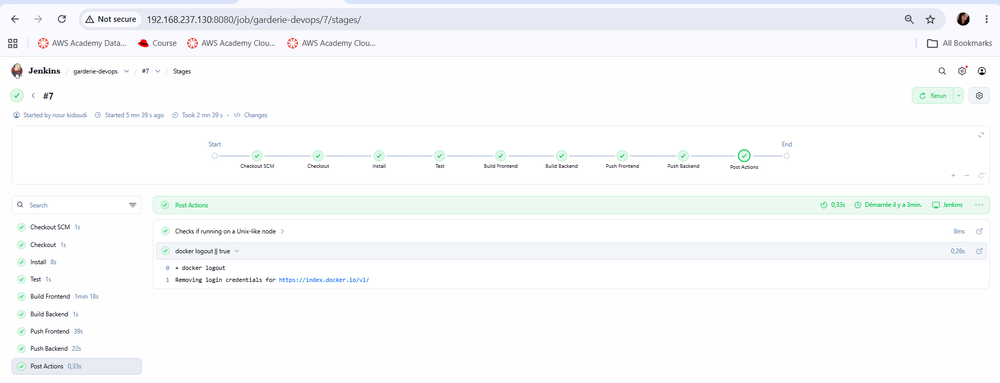
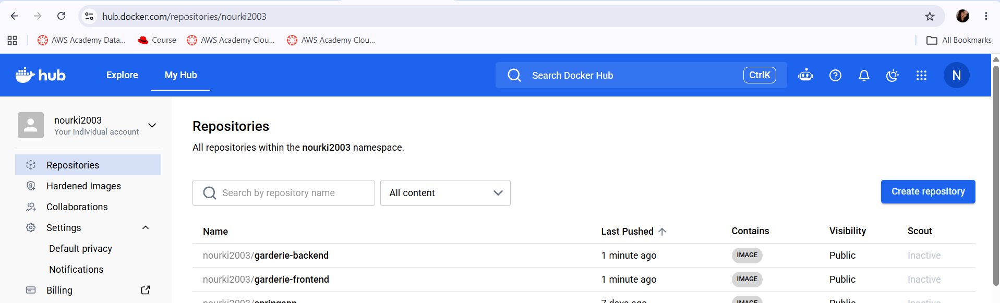
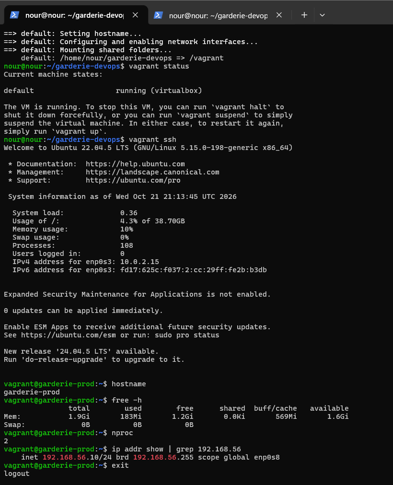
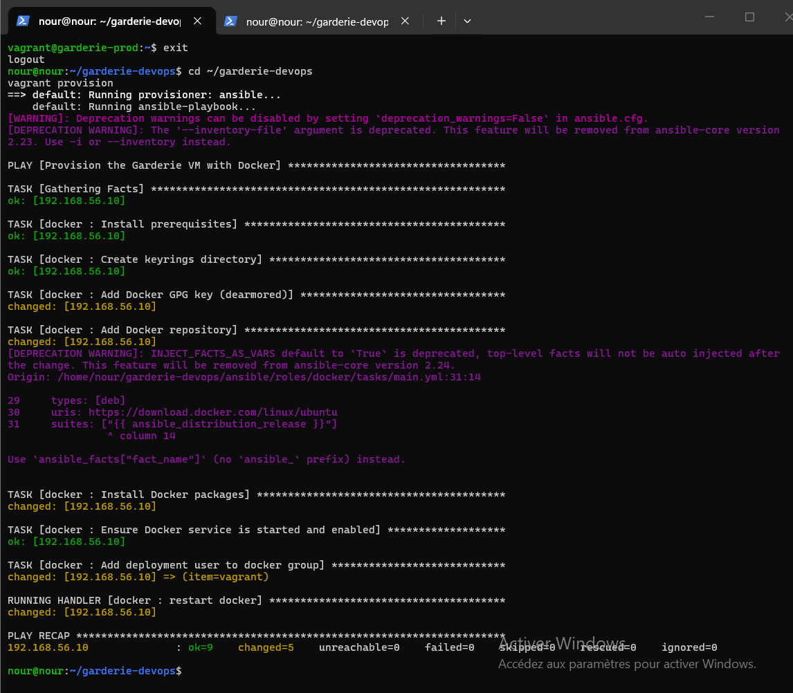
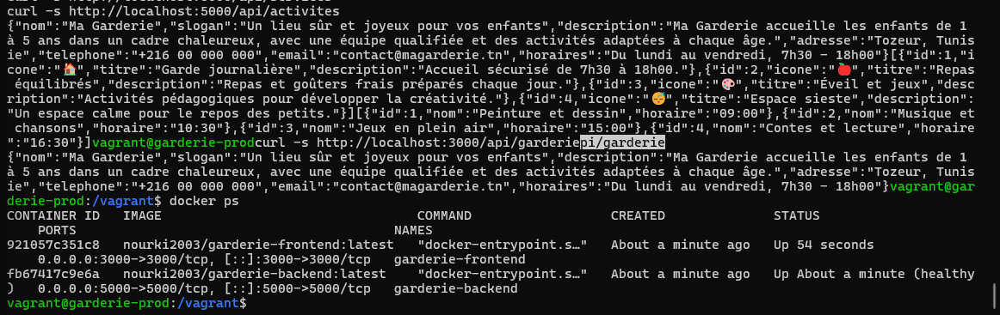
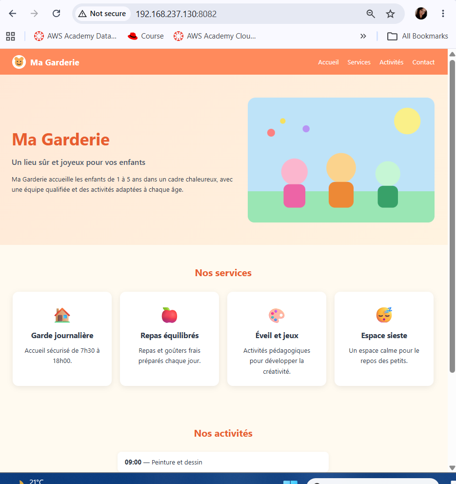

# Ma Garderie — Chaîne CI/CD Jenkins, Docker, Vagrant et Ansible

Application web pour une garderie d'enfants, livrée par une chaîne DevOps complète :
code sur GitHub → pipeline Jenkins → images Docker Hub → VM Vagrant provisionnée par Ansible → déploiement avec Docker Compose.

- **Dépôt GitHub** : https://github.com/nourkidoudi/garderie-devops
- **Image frontend** : https://hub.docker.com/r/nourki2003/garderie-frontend
- **Image backend** : https://hub.docker.com/r/nourki2003/garderie-backend

---

## 1. Présentation et technologies

**Ma Garderie** est une landing page responsive composée de trois composants (`Navbar`, `Hero`, `Services`). Les informations affichées sont fournies dynamiquement par une API REST.

| Couche | Technologie |
|---|---|
| Frontend | Next.js (React) |
| Backend | Node.js / Express |
| Test automatisé | Jest + Testing Library (vérifie le titre « Ma Garderie ») |
| Conteneurs | Docker, Docker Compose |
| CI/CD | Jenkins (Pipeline as Code, `Jenkinsfile`) |
| Registre d'images | Docker Hub |
| Machine virtuelle | Vagrant + VirtualBox (Ubuntu Server 22.04) |
| Provisioning | Ansible (rôle `docker`) |

### API REST du backend

| Méthode | Route | Contenu |
|---|---|---|
| GET | `/api/garderie` | Informations générales de la garderie |
| GET | `/api/services` | Liste des services proposés |
| GET | `/api/activites` | Liste des activités |

---

## 2. Architecture

### Structure du dépôt

```
garderie-devops/
├── frontend/                 # Next.js (components Navbar, Hero, Services) + Dockerfile + test
├── backend/                  # API Express + Dockerfile
├── ansible/
│   ├── inventory.ini
│   ├── site.yml              # Playbook principal
│   └── roles/docker/         # Rôle : installation de Docker Engine + plugin Compose
├── Jenkinsfile               # Pipeline CI/CD
├── Vagrantfile               # VM Ubuntu (2 Go RAM, 2 vCPU, IP 192.168.56.10)
├── docker-compose.yml        # Déploiement : images Docker Hub (sans build)
├── docker-compose.build.yml  # Développement local : construit les images
└── screenshots/              # Captures d'écran
```

### Chaîne CI/CD

```
Développeur ──push──> GitHub ──checkout──> Jenkins
                                              │  Install → Test → Build → Push
                                              ▼
                                         Docker Hub
                                  (garderie-frontend, garderie-backend)
                                              │  docker compose pull
                                              ▼
              Vagrant crée la VM ──Ansible installe Docker──> VM 192.168.56.10
                                              │  docker compose up -d
                                              ▼
                              frontend :3000  ⇄  backend :5000
                                 (réseau Docker garderie-net)
```

Dans le déploiement, le frontend joint le backend par le nom de service Docker `backend` sur le réseau `garderie-net`.

### Branches Git

| Branche | Contenu |
|---|---|
| `feature/vagrant` | `Vagrantfile` |
| `feature/ansible` | Structure Ansible et rôle `docker` |
| `feature/deployment` | `docker-compose.yml` de déploiement |
| `docs/readme` | README et captures d'écran |

Toutes les branches sont fusionnées dans `main`.

---

## 3. Création et provisioning de la VM

### Prérequis
VirtualBox, Vagrant et Ansible installés sur la machine qui lance Vagrant. Pour une VM imbriquée, la virtualisation imbriquée doit être activée dans l'hyperviseur.

### Caractéristiques de la VM

| Paramètre | Valeur |
|---|---|
| Système | Ubuntu Server 22.04 (`ubuntu/jammy64`) |
| RAM | 2 Go |
| CPU | 2 vCPU |
| Réseau privé | IP fixe `192.168.56.10` |

### Commandes

```bash
git clone https://github.com/nourkidoudi/garderie-devops.git
cd garderie-devops

vagrant up            # crée la VM et lance le provisioning Ansible
vagrant status        # la VM doit être « running »
vagrant ssh           # connexion SSH à la VM
```

Pour rejouer uniquement le provisioning :

```bash
vagrant provision
```

### Rôle Ansible `docker`

Le rôle `ansible/roles/docker` :
1. installe les prérequis et ajoute le dépôt officiel Docker ;
2. installe Docker Engine et le plugin Docker Compose ;
3. démarre et active le service Docker ;
4. ajoute l'utilisateur de déploiement (`vagrant`) au groupe `docker`.

Vérification dans la VM :

```bash
docker --version
docker compose version
```

---

## 4. Exécution du pipeline Jenkins

Le pipeline est défini dans le `Jenkinsfile` à la racine (Pipeline as Code).

### Configuration
1. **Credentials** : *Manage Jenkins → Credentials → Global → Add Credentials*, type *Username with password* (identifiant Docker Hub + jeton d'accès), ID : `dockerhub-creds`.
2. **Job** : *New Item → Pipeline → Pipeline script from SCM* → Git → URL du dépôt → branche `main` → Script Path `Jenkinsfile`.
3. Jenkins doit disposer de Node.js 20 et de Docker (l'utilisateur de Jenkins appartient au groupe `docker`).
4. Cliquer sur **Build Now**.

### Étapes du pipeline

| Étape | Rôle |
|---|---|
| Checkout | Récupère le code depuis GitHub |
| Install | Installe les dépendances du frontend et du backend |
| Test | Exécute le test automatisé du frontend |
| Build Frontend | Construit l'image Docker du frontend |
| Build Backend | Construit l'image Docker du backend |
| Push Frontend | Publie l'image sur Docker Hub |
| Push Backend | Publie l'image sur Docker Hub |

Si le test échoue, le pipeline s'arrête : les étapes de build et de push ne sont pas exécutées. Les identifiants Docker Hub sont gérés exclusivement par Jenkins Credentials, ils n'apparaissent pas dans le dépôt.

---

## 5. Images Docker Hub

| Image | Lien |
|---|---|
| Frontend | https://hub.docker.com/r/nourki2003/garderie-frontend |
| Backend | https://hub.docker.com/r/nourki2003/garderie-backend |

```bash
docker pull nourki2003/garderie-frontend:latest
docker pull nourki2003/garderie-backend:latest
```

---

## 6. Déploiement avec Docker Compose

Le `docker-compose.yml` utilise les deux images publiées sur Docker Hub : aucune image n'est reconstruite dans la VM.

```bash
vagrant ssh
cd /vagrant
docker compose pull
docker compose up -d
docker compose ps
```

Vérification des trois API :

```bash
curl -s localhost:5000/api/garderie
curl -s localhost:5000/api/services
curl -s localhost:5000/api/activites
```

Le frontend est servi sur le port `3000` et le backend sur le port `5000`.

Pour un test en local avec construction des images :

```bash
docker compose -f docker-compose.build.yml up --build
```

---

## 7. Adresse d'accès à l'application

| Depuis | Adresse |
|---|---|
| La machine hôte de Vagrant | `http://192.168.56.10:3000` |
| Une autre machine du réseau | `http://<IP_DE_LA_MACHINE_HÔTE>:8082` |

La VM Vagrant (`192.168.56.10`) est un réseau privé hôte : elle n'est pas directement joignable depuis une autre machine. Pour l'exposer, la machine hôte redirige un port vers la VM :

```bash
sudo apt install -y socat
sudo ufw allow 8082
socat TCP-LISTEN:8082,fork,reuseaddr TCP:192.168.56.10:3000
```

Exemple utilisé pour la démonstration : `http://192.168.237.130:8082`.
L'adresse IP de la machine hôte est attribuée dynamiquement : la vérifier avec `ip -4 a` avant chaque démonstration.

---

## 8. Captures d'écran

**Pipeline Jenkins exécuté avec succès**



**Images publiées sur Docker Hub**



**VM démarrée avec Vagrant**



**Exécution réussie du playbook Ansible**



**Conteneurs Docker en cours d'exécution**



**Application accessible dans le navigateur depuis une autre machine**



---

## Auteur

Nour Kidoudi — Master DevOps & Cloud Computing, ISET Tozeur.
